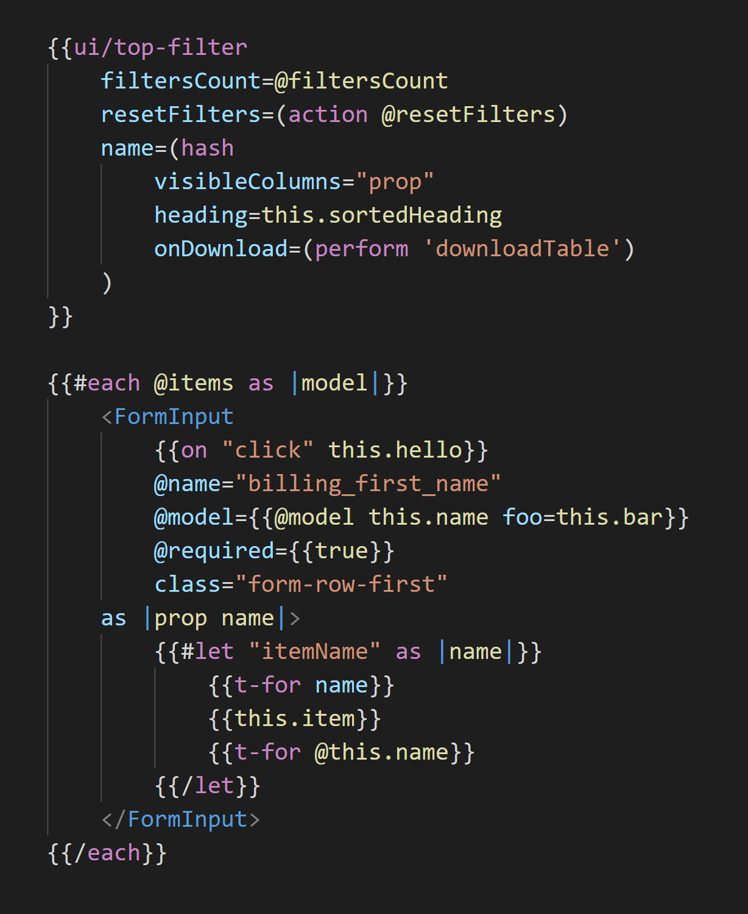
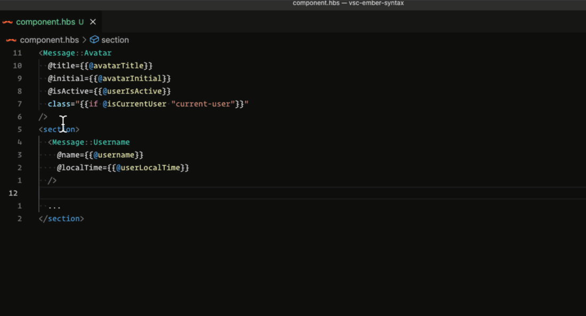

# README

VSCode Ember/Glimmer Syntax Extension.

Best with:

- [Unstable Ember Language Server](https://marketplace.visualstudio.com/items?itemName=lifeart.vscode-ember-unstable)
- [Prettier for Handlebars](https://marketplace.visualstudio.com/items?itemName=EmberTooling.prettier-for-handlebars-vscode)



Change Theme: `Shift+CMD+P` -> Search `Preferences: Color Theme` -> Switch to `Dark+ (default dark)`

Issues: https://github.com/lifeart/vsc-ember-syntax/issues

## Features

- Syntax highlighting of inline hbs blocks.
- IntelliSense for hbs tags and attributes.
- Quick info hovers on tags.
- Auto closing tags.
- Folding html.
- CSS completions in style blocks.
- Works with literal hbs strings that contain placeholders.
- Template tag support
  - In `.gjs` and `.gts` files
  - In `.md` files when specifing `"```gjs"` or `"```gts"` as the language

## Usage

The vsc-ember-syntax extension adds highlighting and IntelliSense for hbs template strings in JavaScript and TypeScript. It works out of the box when you use VS Code's built-in version of TypeScript.

### `.gts` & `.gjs` template tags

The extension adds new language definitions for `.gts` and `.gjs` known as `glimmer-ts` and `glimmer-js` respectively.
These languages are identical to `typescript` and `javascript` except that they add support for the template tag. This means that you can use the template tag in your code and get syntax highlighting and IntelliSense for the template.

```gjs
import Component from '@glimmer/component';

export default class MyComponent extends Component {
  get greeting() {
    return 'Hello';
  }

  <template>
    <div>{{this.greeting}} World!</div>
  </template>
}
```

## Customizing the theme


In your vscode `settings.json` file:

```json
// https://code.visualstudio.com/docs/getstarted/themes
"editor.tokenColorCustomizations": {
    "textMateRules": [
        {
            "scope": [
                "text.html.ember-handlebars meta.tag.any.ember-handlebars entity.other.attribute-name.ember-handlebars.argument",
            ],
            "settings": {
                "foreground": "#47c7b3",
            }
        }
    ]
}
```

If you are using VS Code 1.30 or older and are using a workspace version of typescript, you must currently configure the TS Server plugin manually by following these instructions

## Development

### Prerequisites

- Node.js 16+
- Yarn

### Building Grammars

The TextMate grammar files are generated from source files in `syntaxes/src/`. After making changes to the grammar source files:

```bash
npm run build:grammars
```

This generates the `.json` grammar files in the `syntaxes/` directory.

### Testing

The extension uses snapshot-based testing to prevent regressions in syntax highlighting.

```bash
# Run tests (compares current tokenization against saved snapshots)
npm test

# Update snapshots after intentional grammar changes
npm run test:update-snapshots
```

**Test structure:**
- `tests/fixtures/` - Test input files (`.hbs`, `.gts`, `.gjs`)
- `tests/snapshots/` - Expected tokenization output
- `tests/run-grammar-tests.mjs` - Test runner
- `tests/update-snapshots.mjs` - Snapshot generator

### Adding New Tests

1. Add a fixture file to `tests/fixtures/` with the syntax you want to test
2. Run `npm run test:update-snapshots` to generate the snapshot
3. Review the snapshot to ensure tokenization is correct
4. The test will now catch any regressions

## Thanks to:

- [vscode-lit-html](https://github.com/mjbvz/vscode-lit-html)
- [Ember Syntax](https://marketplace.visualstudio.com/items?itemName=dhedgecock.ember-syntax)
- [VSCode Glimmer](https://marketplace.visualstudio.com/items?itemName=chiragpat.vscode-glimmer)
- [Grammar](https://macromates.com/manual/en/language_grammars)

## Publishing

How to publish: https://code.visualstudio.com/api/working-with-extensions/publishing-extension
